<h1 align="center">🚓 PDAssist v1.0 — B-Zone RPG</h1>

  <b>Modul complet pentru LSPD / LVPD / SFPD / FBI / NG, refăcut de la zero în MoonLoader.</b> 
  Meniuri moderne, roată de interacțiune, HUD, notificări și automatizări. Totul se configurează din joc.

  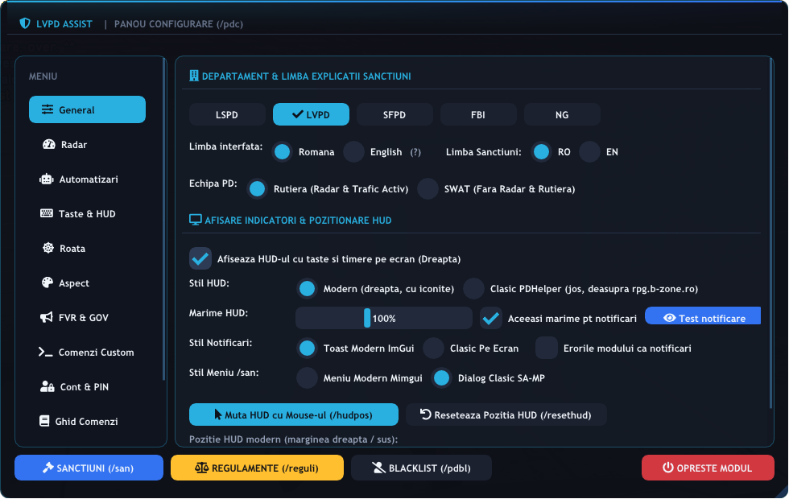

> Ești la început și îți e frică să nu greșești sancțiunile? Sau ești veteran și te-ai săturat să scrii aceleași comenzi de 100 de ori pe tură? PDAssist e făcut pentru amândouă situațiile.

PDAssist pornește de la **PDHelper V7.5 (CLEO)** de TheTom. Toate comenzile vechi au rămas, ca să te simți ca acasă. Pe deasupra are interfață nouă (mimgui), meniu de interacțiune în formă de roată și multe funcții noi, unele inspirate din NG-Helper.

🇬🇧 *English speaker? Jump to the [English section](#-english).*

---

## 🎯 Roata de interacțiune: tasta **F2**

  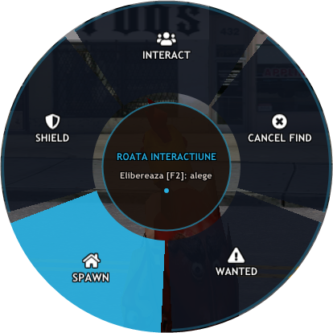
  &nbsp;&nbsp;
  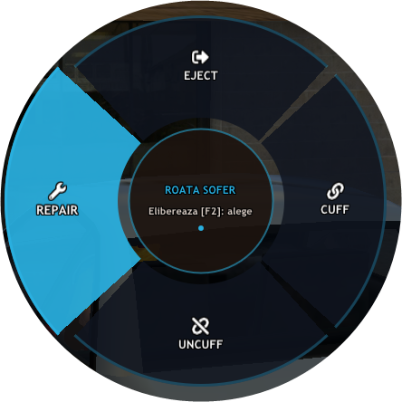

<i>Pe jos &nbsp;·&nbsp; În mașină (șofer)</i>

- **Șofer:** Eject / Cuff / Uncuff / Repair.
- **Pe jos:** Interact → alegi jucătorul de lângă tine → Frisk, Confiscă, Wanted, Sancțiuni sau Licențe. În Jail apar și Cuff și Punish, cu Punish primul.
- Mai are pe jos Spawn, Shield, Cancel find și Duty (Duty doar în interior).
- În Jail știe în ce **celulă** e fiecare jucător.
- Vezi doar jucătorii pe care chiar îi vezi pe ecran: nu prin pereți și nu pe cei cu nametag ascuns.
- **Protecție colegi:** nu dai din greșeală frisk, confiscare sau wanted unui coleg (același nume colorat ca tine).
- **Hold** (ții tasta și eliberezi pe felie) sau **Touch** (apeși o dată ca s-o deschizi).

### Complet personalizabilă
- Schimbi ordinea feliilor prin drag & drop și ascunzi ce nu folosești, pe fiecare nivel și submeniu.
- Îți adaugi **felii și submeniuri proprii** cu comenzile tale.
- Ai **preview live** pe ecran: dai click pe o felie cu `>` ca să intri în submeniu, iar lista de ordine te urmează.
- Poți schimba mărimea roții.

  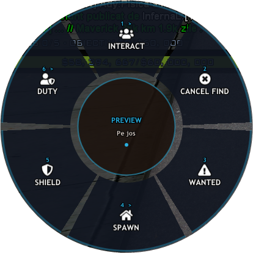
  &nbsp;
  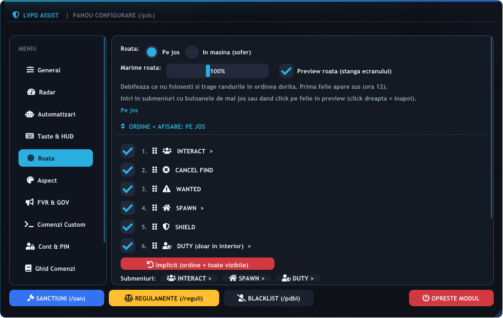

---

## ⚖️ Sancțiuni rapide: `/san`

- Un meniu cu toate sancțiunile, wanted-urile și controalele. Alegi jucătorul (după ID, cel mai apropiat sau din radar) și motivul, iar modul scrie comanda corectă.
- Ține cont automat de **nivelul jucătorului** și de **jail**, acolo unde regulamentul o cere (NOS, contrasens, parcare, alcoolemie peste 3.0 etc.).
- Sancțiunile se trimit în **română sau engleză**, în funcție de jucătorul pe care îl sancționezi.
- Dacă îți place stilul vechi, poți folosi varianta cu dialog SA-MP.

  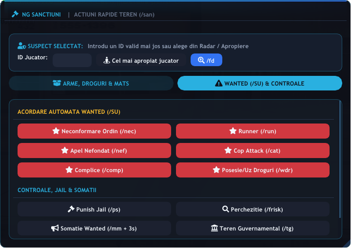
  &nbsp;
  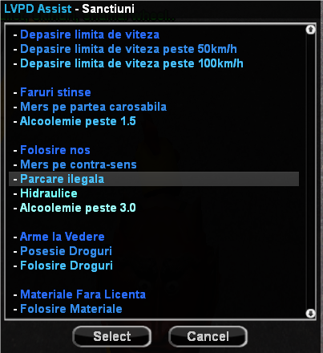

<i>Meniul modern &nbsp;·&nbsp; Dialogul clasic SA-MP</i>

---

## 🖥️ HUD și notificări

- **HUD modern** (dreapta, cu iconițe) sau **HUD clasic PDHelper** (fontul Days, ca pe vremuri).
- Alegi ce taste apar în HUD și în ce ordine (drag & drop). Fiecare tastă custom își poate avea iconița ei.
- Muți HUD-ul cu mouse-ul (`/hudpos`) și îl faci mai mare sau mai mic pentru ecrane mici.
- **Notificări pop-up** deasupra radarului, cu **culori la alegere** și preview. Opțional, și erorile modului pot apărea ca notificări, nu în chat.

  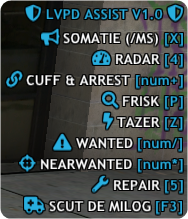
  &nbsp;&nbsp;
  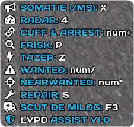
  &nbsp;&nbsp;
  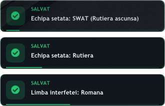

<i>HUD modern &nbsp;·&nbsp; HUD clasic PDHelper &nbsp;·&nbsp; Notificări</i>

---

## 📝 Personal Blacklist: `/pdbl`

- Lista ta privată de jucători, cu notițe.
- O poți **fixa pe ecran**: vezi imediat cine e **ON** și cu ce ID.
- O muți și o lărgești cu mouse-ul: `/blpos`.

  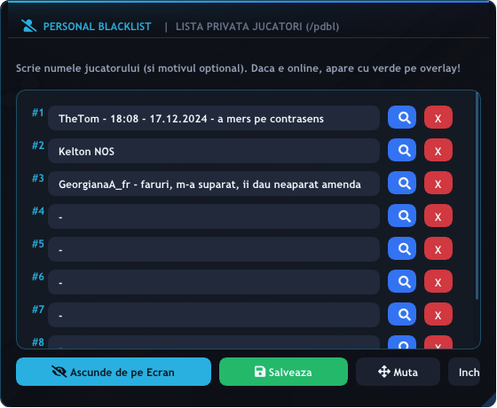
  &nbsp;
  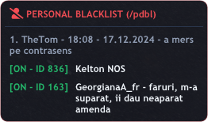

---

## 📖 Regulamentele în joc: `/reguli`

Regulamentul Departamentelor, PD, FBI și NG, în română și engleză, cu căutare în tot textul.

  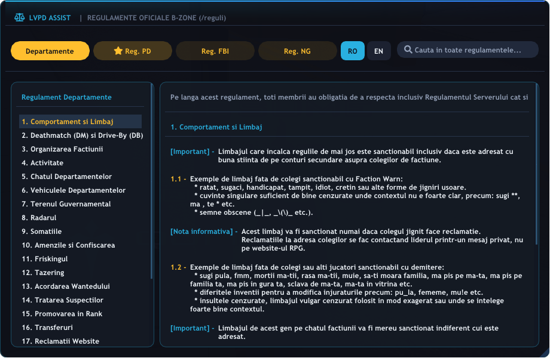

---

## 🗂️ Panoul /pdc, tab cu tab

Tot modul se configurează de aici: tasta **K** sau `/pdc`.

### General
Departamentul (LSPD / LVPD / SFPD / FBI / NG), echipa PD (Rutieră / SWAT), limba interfeței, limba sancțiunilor, stilul HUD-ului, al notificărilor și al meniului `/san`.

Toată interfața poate fi și în **engleză**:

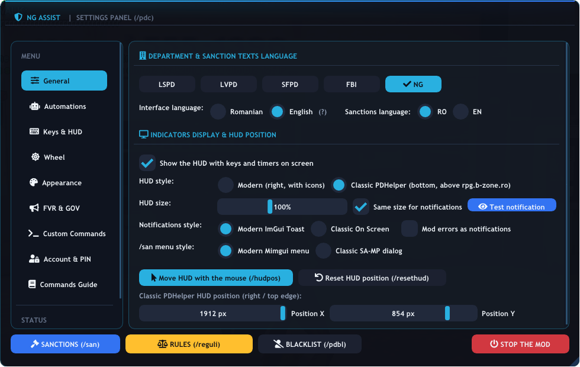

### Radar *(doar pentru Rutieră)*
Zona și limita radarului, cu limite rapide și **presetări de zone** (un click setează zona și limita).

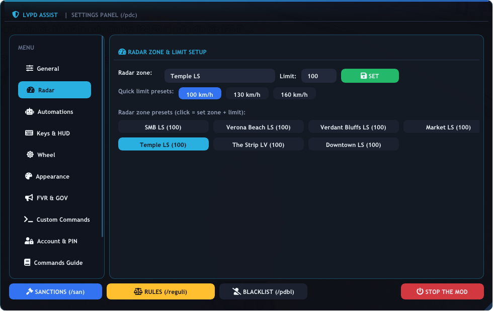

### Automatizări
Auto-Engine, Start-Stop, tasta C pentru porți, bariere și lifturi, comenzile prescurtate, raza de frisk și anularea automată a `/find`. Tot aici e explicat `/afk`, `/ffk` și `/ms`.

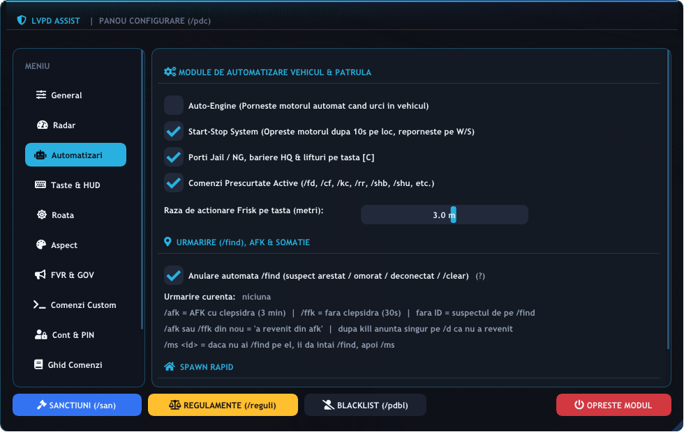

### Taste & HUD
Fiecare tastă se schimbă dintr-un click și apare sau nu în HUD. Mai jos în tab sunt keybind-urile tale, cu iconițe, și ordinea din HUD.

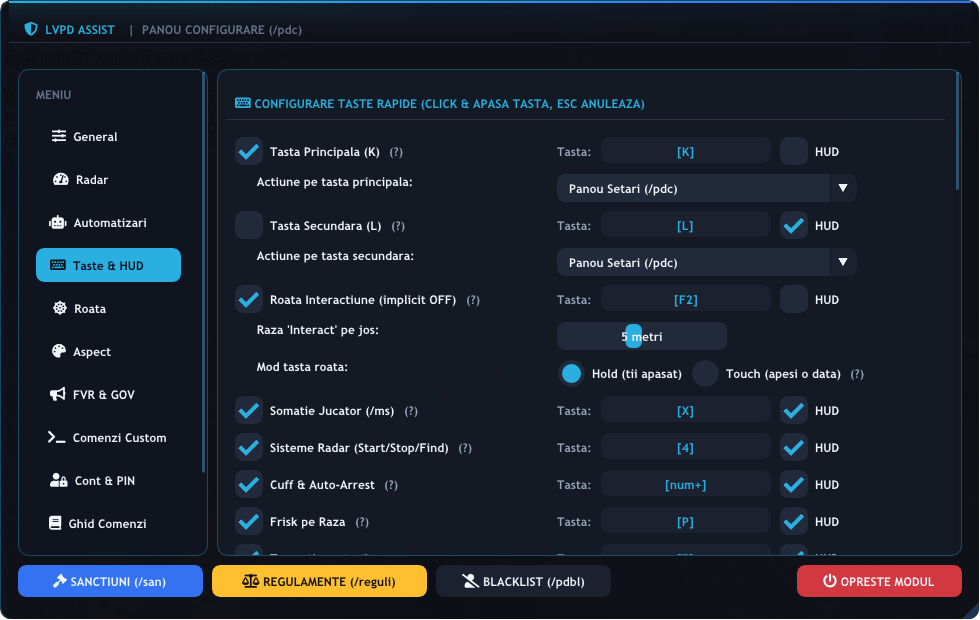

### Roata
Hold / Touch, mărimea, ordinea și afișarea feliilor pe fiecare nivel, feliile tale și preview-ul de pe ecran.

### Aspect
Culorile HUD-ului și ale notificărilor, cu presetări rapide și opacitate.

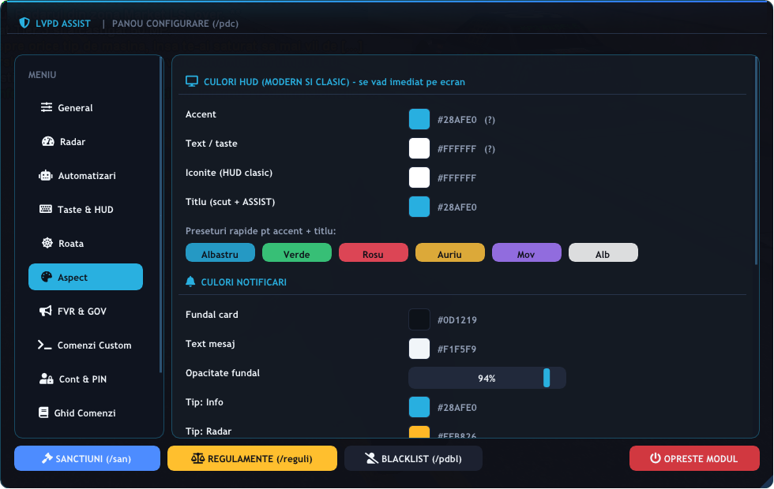

### FVR & GOV
Textele pentru FVR pe `/r` și `/d`, secundele de așteptare și liniile de `/gov`.

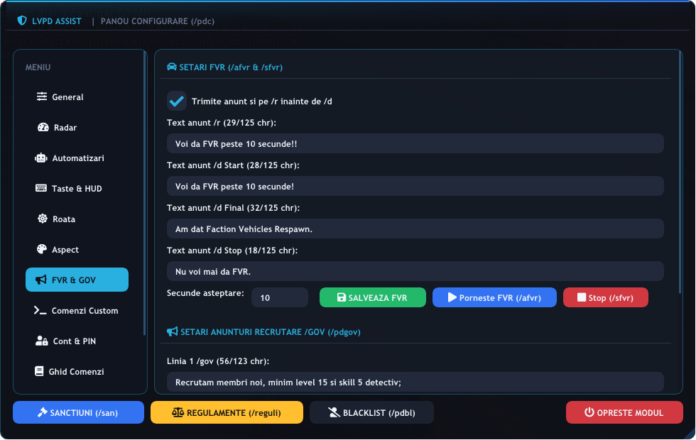

### Comenzi Custom
Până la 100 de scurtături proprii, cu variabile (`<ID>`, `<Nume>`, `<Apropiat>`, `<Dept>`…) și mai multe comenzi una după alta.

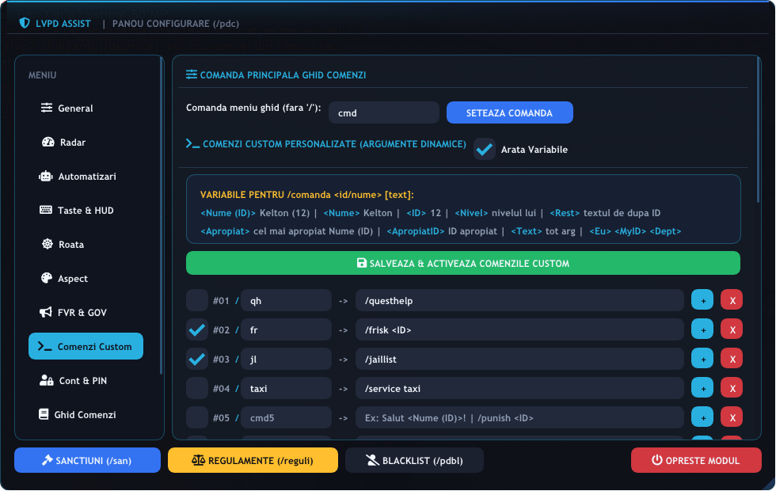

### Cont & PIN
Login și PIN automat. Parola și PIN-ul se salvează **criptat** (Windows DPAPI), așa că nu pot fi citite pe alt PC sau alt cont de Windows.

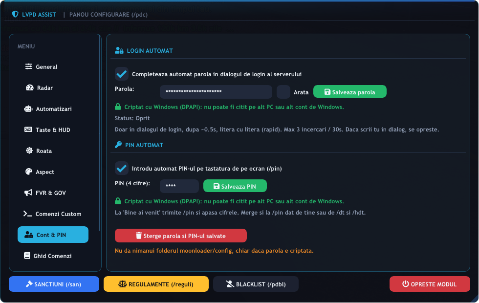

### Ghid Comenzi
Toate comenzile modului, pe categorii, cu căutare.

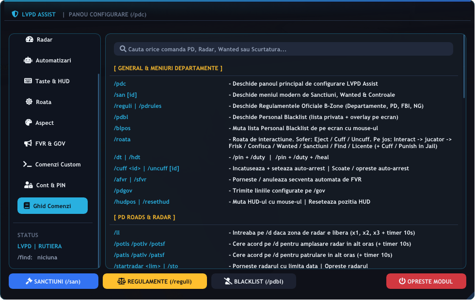

---

## ✨ Și pe lângă astea

- **Rutieră:** `/startradar <limită>` cu radar automat, `/sl` sancționează ultimul vitezoman prins sau unul dintre ultimii 5 (`/last`), `/ll`, `/potls`, `/patls` pentru întrebări pe `/d`, cu timer.
- **Wanted:** comenzi pentru fiecare motiv (`/nec`, `/run`, `/nef`, `/cat`, `/notp`, `/comp`, `/wdr`, `/bm`).
- **Somație:** `/ms <id>`. Dacă nu ai `/find` pe jucător, îi dă întâi `/find`.
- **Auto-arrest:** `/cuff <id>` și ID-ul arestului apare în HUD până îl duci la secție.
- **/find inteligent:** se anulează singur când HQ-ul anunță că suspectul a fost arestat sau omorât ori s-a deconectat.
- **AFK:** `/afk` / `/ffk`, cu clepsidră de 3 minute sau 30 de secunde.
- **Jail:** `/jc` arată lista din `/jaillist` cu celula fiecăruia.
- **Duty:** `/dt` / `/hdt` dau `/pin` + `/duty` (+ `/heal`) dintr-o singură comandă.
- **FVR și GOV:** `/afvr` pornește numărătoarea de FVR, `/sfvr` o anulează, `/pdgov` trimite liniile de `/gov`.
- **Spawn direct:** `/scasa`, `/slspd`, `/slvpd`, `/ssfpd`, `/sfbi`, `/sjail`, `/sclan`, `/sbunker`, `/hqf`, `/hqng`.
- **Keybind-uri:** până la 50 de taste care trimit textul sau comenzile tale.

---

## ⌨️ Taste implicite

Toate tastele se pot schimba sau dezactiva din `/pdc → Taste & HUD`.

| Tastă | Ce face |
|:---:|---|
| **K** | Deschide `/pdc` (poate fi setată și pe meniul `/san`) |
| **F2** | Roata de interacțiune *(pornită din /pdc)* |
| **X** | Somație |
| **4** | Radar |
| **num +** | Cuff & Arrest (doar din mașină) |
| **P** | Frisk pe cel mai apropiat jucător |
| **Z** | Tazer |
| **num /** | Wanted |
| **num \*** | Nearwanted |
| **5** | Repair |
| **C** | Porți / lift la Jail și NG |

---

## 📋 Comenzi

Lista completă se vede și în joc, la `/cmd` sau în `/pdc → Ghid Comenzi`.

<b>Meniuri și setări</b>

| Comandă | Ce face |
|---|---|
| `/pdc` | Panoul principal de configurare |
| `/san [id]` | Meniul de sancțiuni, wanted și controale |
| `/reguli` · `/pdrules` | Regulamentele oficiale B-Zone (Departamente, PD, FBI, NG) |
| `/pdbl` | Personal Blacklist |
| `/blpos` | Muți blacklist-ul de pe ecran |
| `/roata` | Deschide roata de interacțiune |
| `/hudpos` · `/resethud` | Muți HUD-ul · resetezi poziția |

<b>Rutieră și radar</b>

| Comandă | Ce face |
|---|---|
| `/startradar <lim>` · `/sto` | Pornește / oprește radarul |
| `/last` | Ultimii 5 jucători prinși pe radar |
| `/sl` · `/sl <id>` | Sancționează ultimul vitezoman / unul din ultimii 5 |
| `/ll` | Întreabă pe /d dacă zona de radar e liberă |
| `/potls` `/potlv` `/potsf` | Acord pe /d pentru radar în alt oraș |
| `/patls` `/patlv` `/patsf` | Acord pe /d pentru patrulare în alt oraș |
| `/aa <id>` | Depășirea limitei de viteză (10–50 km/h) |
| `/aa50 <id>` · `/aa100 <id>` | Depășire +50 / +100 km/h |
| `/faruri <id>` | Faruri stinse |
| `/car <id>` | Mers pe partea carosabilă |
| `/alc15 <id>` · `/alc30 <id>` | Alcoolemie peste 1.5 / peste 3.0 |
| `/nos <id>` | Folosire NOS |
| `/con <id>` | Contrasens |
| `/parc <id>` | Parcare neregulamentară |
| `/hidra <id>` | Hidraulice |

<b>Wanted, confiscări și jail</b>

| Comandă | Ce face |
|---|---|
| `/nec <id>` | Wanted: neconformare |
| `/run <id>` | Wanted: runner |
| `/nef <id>` | Wanted: apel nefondat |
| `/cat <id>` | Wanted: cop attack |
| `/notp <id>` | Wanted: neplată amendă |
| `/comp <id>` | Wanted: complice |
| `/wdr <id>` | Wanted: droguri |
| `/bm <id>` | Confiscă bombele + mesaj + wanted |
| `/ms [id]` | Somație (dă /find întâi dacă e nevoie) |
| `/mm <id>` | Somație pe /m să tragă pe dreapta |
| `/cuff <id>` · `/uncuff [id]` | Încătușează + auto-arrest · scoate |
| `/arme <id>` | Confiscă armele |
| `/dr` · `/cdr <id>` | Droguri: posesie / consum |
| `/mats <id>` · `/matslic <id>` | Materiale / materiale fără licență |
| `/cl <id>` | Control de rutină + frisk |
| `/rl <id>` | Cere licențele |
| `/tg <id>` | Somație: teritoriu guvernamental |
| `/ps <id/nume>` | /punish în Jail |
| `/jc` · `/jl` | Jail list cu celule · /jaillist |
| `/afk [id]` · `/ffk [id]` · `/stopafk` | Anunț AFK (3 min / 30 s) · oprire |

<b>Spawn, duty și utilitare</b>

| Comandă | Ce face |
|---|---|
| `/scasa` `/slspd` `/slvpd` `/ssfpd` `/sfbi` `/sjail` | Schimbă spawn-ul direct |
| `/sclan` `/sbunker` | Spawn la HQ clan / bunker |
| `/hqf` · `/hqng` | HQ-ul facțiunii tale · garajul NG |
| `/dt` · `/hdt` | /pin + /duty · /pin + /duty + /heal |
| `/afvr` · `/sfvr` | Pornește / anulează FVR |
| `/pdgov` | Trimite /gov |
| `/fd <id/nume>` · `/cf` · `/kc` | /find · /cancel find · /killcp |
| `/shb` · `/shu` · `/shr` | /shield buy · use · remove |
| `/rr` · `/rep` · `/ref` | /repair + /refill · /repair · /refill |
| `/at <id>` · `/ct` · `/acp` | /accept ticket · /cancel ticket · /acceptpoints |
| `/mb` · `/cmb` · `/ra` · `/st` | /members · /clanmembers · /raport · /stats |
| `/ha` · `/sa` · `/sp` · `/en` | /heal · /stopanim · /spawnchange · /engine |
| `/bg <armă> <gl>` · `/gk <id>` | /buygun · /givekey |
| `/sal` · `/nb` · `/cch` | Salut / noapte bună · curăță chatul |
| `/ton` `/toff` `/not` `/missm` `/missc` | Telefon, notificări, apeluri/SMS pierdute |

---

## 📥 [RO] Instalare

**Ce îți trebuie:**
1. GTA San Andreas **1.0 US**.
2. SA-MP **0.3.7-R1** sau **0.3.DL**.
3. **SAMPFUNCS** potrivit versiunii tale de SA-MP. **Fără el, modul nu pornește.**
   - 0.3.7-R1 → SAMPFUNCS **5.4.1**
   - 0.3.DL → SAMPFUNCS **5.6.0** (pentru 0.3.DL)
4. **MoonLoader v026**. E deja inclus în arhivă.

**Pași:**
1. Descarcă arhiva din [**Releases**](../../releases) sau de la butonul verde **Code → Download ZIP**.
2. Copiază `moonloader`, `MoonLoader.asi` și `lua51.dll` în folderul jocului, unde e `gta_sa.exe`.
3. Dacă te întreabă de înlocuire, alege **Da**. Sunt bibliotecile standard MoonLoader și nu strică alte moduri.
4. Intră în joc. În chat apare `[PDAssist] v1.0 incarcat!`.
5. Apasă **K** sau scrie `/pdc` → **General** și alege-ți departamentul (LSPD / LVPD / SFPD / FBI / NG). La PD alegi și echipa: Rutieră sau SWAT.

> ⚠️ **Nu folosi în același timp PDHelper (CLEO) sau NG-Helper.** Fac aceleași lucruri pe aceleași taste și intră în conflict.

---

## ❓ Probleme frecvente

**Modul nu pornește sau nu apare nimic în chat.**
De cele mai multe ori e SAMPFUNCS lipsă sau pentru altă versiune de SA-MP. Verifică lista de mai sus. Eroarea exactă o găsești în `moonloader\moonloader.log`.

**Iconițele apar ca pătrățele.**
Lipsește `moonloader\resource\fonts\fa-solid-900.ttf`. Copiază din nou folderul `resource` din arhivă.

**Nu se completează parola la login.**
Salveaz-o din nou în `/pdc → Cont & PIN`. Parola criptată merge doar pe contul de Windows pe care a fost salvată, așa că dacă ai mutat jocul pe alt PC sau alt cont, trebuie salvată iar.

**Unde sunt setările mele?**
În `moonloader\config\PDAssist.ini` (setări) și `moonloader\config\PDAssist_wheel.txt` (roata personalizată). Fă-le copie dacă reinstalezi jocul.

**Am găsit un bug sau am o idee.**
Deschide un [Issue](../../issues) aici pe GitHub. Spune ce ai făcut, ce trebuia să se întâmple și ce s-a întâmplat de fapt. Dacă ai o poză, pune-o și pe ea.

---

## 🇬🇧 English

**PDAssist** is a MoonLoader mod for **B-Zone RPG** police factions (LSPD / LVPD / SFPD / FBI / NG), based on TheTom's **PDHelper V7.5 (CLEO)**. It keeps all the old commands and adds:
- a modern UI;
- an interaction wheel;
- a customizable HUD and pop-up notifications;
- automation: auto-arrest, smart `/find`, login/PIN, gate key.

**The whole interface can be switched to English** in `/pdc → General → Interface language`. The language of the sanction messages sent to players is a separate setting.

### [En] Install instructions
1. You need GTA SA **1.0 US**, SA-MP **0.3.7-R1** or **0.3.DL**, and the matching **SAMPFUNCS**: 5.4.1 for R1, 5.6.0 for 0.3.DL. Without SAMPFUNCS the mod won't start.
2. Download the archive from [**Releases**](../../releases) (or **Code → Download ZIP**).
3. Copy `moonloader`, `MoonLoader.asi` and `lua51.dll` into your game folder (where `gta_sa.exe` is). Overwrite if asked.
4. Join the server. You should see `[PDAssist] v1.0 loaded!` in chat.
5. Press **K** or type `/pdc`, pick your department in **General** and switch the interface language to English.

> ⚠️ Don't run PDHelper (CLEO) or NG-Helper at the same time. They use the same keys and will conflict.

**Default keys:**
- K: `/pdc`
- F2: interaction wheel (enable it in /pdc first)
- X: stop order
- 4: radar
- num+: cuff & arrest
- P: frisk
- Z: taser
- num/: wanted
- num\*: nearwanted
- 5: repair
- C: gates and lift

Full command list in game: `/cmd` or `/pdc → Commands Guide`.

---

## 📜 Changelog

### v1.0
- Prima versiune PDAssist: PDHelper V7.5 rescris complet în MoonLoader / mimgui.
- Toate comenzile PDHelper + funcții noi: roata de interacțiune, HUD modern și clasic, notificări, login/PIN automat, /find inteligent, comenzi și taste custom, interfață RO/EN.

---

## 🙏 Credite

- **TheTom**: autorul **PDHelper** (CLEO), baza acestui mod.
- **SyLvy**: PDAssist (rescriere MoonLoader, funcții noi).
- Idei preluate din **NG-Helper**.
- Biblioteci: [MoonLoader](https://www.blast.hk/threads/13305/), mimgui, SAMP.Lua, fAwesome5.

> Modul e făcut pentru **B-Zone RPG** și respectă regulamentul serverului. Toate comenzile sunt cele pe care le-ai scrie și tu de mână, modul doar le scrie mai repede.
